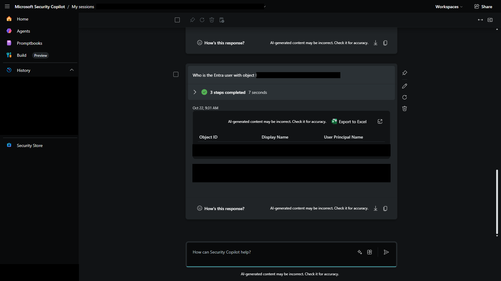

# Entra Principal Resolver — Companion Plugin

[<- Azure RBAC Inventory Module](../README.md)

A second Security Copilot plugin that resolves the raw GUIDs returned by the [Azure Subscription & RBAC Inventory plugin](../Plugin/README.md) into human-readable names, by calling **Microsoft Graph** instead of Azure Resource Manager.

---

## Why a Separate Plugin

Azure Resource Manager (ARM) and Microsoft Graph are **different OAuth token audiences**. A single Security Copilot plugin authenticates with one `TokenEndpoint` + `Scopes` combination, producing a token valid for exactly one audience. A token scoped to `https://management.azure.com/.default` (used by the RBAC Inventory plugin) is rejected by Microsoft Graph, and vice versa.

So instead of trying to force both APIs into one plugin, this is a **second, independent plugin** that reuses the **same Entra App Registration** (same ClientId/ClientSecret) but requests tokens scoped to `https://graph.microsoft.com/.default`. Security Copilot's orchestrator can call both plugins in the same conversation — it already chains multiple tool calls per prompt when needed (for example, listing role assignments and then resolving each principal name).

## Skills Exposed

| Skill | Graph endpoint | Resolves |
|---|---|---|
| `ResolveEntraUserById` | `GET /users/{id}` | A `"User"` principalId to display name + UPN |
| `ResolveEntraServicePrincipalById` | `GET /servicePrincipals/{id}` | A `"ServicePrincipal"` principalId to display name + app ID |
| `ResolveEntraGroupById` | `GET /groups/{id}` | A `"Group"` principalId to display name |

## Prerequisites

- The **same** Entra App Registration used for the [Azure Subscription & RBAC Inventory plugin](../Plugin/README.md)
- Microsoft Graph **Application permissions** granted to that app registration, with admin consent:
  - `User.Read.All`
  - `Application.Read.All`
  - `Group.Read.All`

## Setup

### 1. Add Microsoft Graph API permissions to the existing app registration

In the Azure Portal, open the app registration from the RBAC Inventory plugin setup (**API permissions > Add a permission > Microsoft Graph > Application permissions**) and add:

- `User.Read.All`
- `Application.Read.All`
- `Group.Read.All`

Then click **Grant admin consent** — Application permissions do not work until an administrator consents.

Equivalent Azure CLI:

```powershell
$graphAppId   = "00000003-0000-0000-c000-000000000000"
$userReadAll  = "df021288-bdef-4463-88db-98f22de89214"   # User.Read.All
$appReadAll   = "9a5d68dd-52b0-4cc2-bd40-abcf44ac3a30"    # Application.Read.All
$groupReadAll = "5b567255-7703-4780-807c-7be8301ae99b"    # Group.Read.All

az ad app permission add --id <app-client-id> --api $graphAppId `
  --api-permissions "$userReadAll=Role" "$appReadAll=Role" "$groupReadAll=Role"

az ad app permission admin-consent --id <app-client-id>
```

### 2. Upload the plugin to Security Copilot

Same flow as the RBAC Inventory plugin (**Sources > Custom > Upload plugin > Security Copilot plugin > Upload as a link**), pointing at [`manifest.yaml`](manifest.yaml).

### 3. Configure auth

Security Copilot will again prompt for OAuth Client Credentials fields — reuse the same ClientId/ClientSecret, but change the scope:

| Field | Value |
|---|---|
| **ClientId** | Same as the RBAC Inventory plugin |
| **ClientSecret** | Same as the RBAC Inventory plugin |
| **TokenEndpoint** | `https://login.microsoftonline.com/<tenant-id>/oauth2/v2.0/token` |
| **Scopes** | `https://graph.microsoft.com/.default` |

### 4. Test it

With both plugins enabled, ask Security Copilot something like:

> "Who has role assignments on subscription \<id\>, and what are their names?"

The orchestrator calls `ListSubscriptionRoleAssignments` (ARM plugin) to get principal IDs and types, then calls `ResolveEntraUserById` / `ResolveEntraServicePrincipalById` (this plugin) for each one to resolve a readable name — turning a table of GUIDs into a table of actual people, apps, and groups.

## Verified Example

Resolving a known object ID directly confirms the plugin works end-to-end:

| Object ID | Resolved via | Result |
|---|---|---|
| `d5a157af-...` | `ResolveEntraUserById` | displayName: `System Administrator`, UPN: `admin@<tenant>.onmicrosoft.com` |
| `15d05821-...` | `ResolveEntraServicePrincipalById` | displayName: matches the RBAC Inventory plugin's own service principal, appId matches its ClientId |



## Known Behavior: Ask About One Principal Type at a Time

When a single prompt asks Security Copilot to resolve **multiple different principal types in one go** (e.g. "resolve this user ID and this service principal ID"), the orchestrator may only invoke one of the two matching skills and report the other as "could not be resolved" — even though both skills work correctly in isolation. This is a documented Security Copilot behavior called **skill collision**, where very similarly described skills (`ResolveEntraUserById` vs. `ResolveEntraServicePrincipalById`) can be under-disambiguated when requested together.

**Workaround**: Ask about one principal (or one principal type) per prompt — e.g. *"Who is the Entra user with object ID \<id\>?"* — rather than a single compound request covering users and service principals together. Both skills were verified to work correctly end-to-end when asked individually.

---

**Developer**: Dr Muataz Awad
