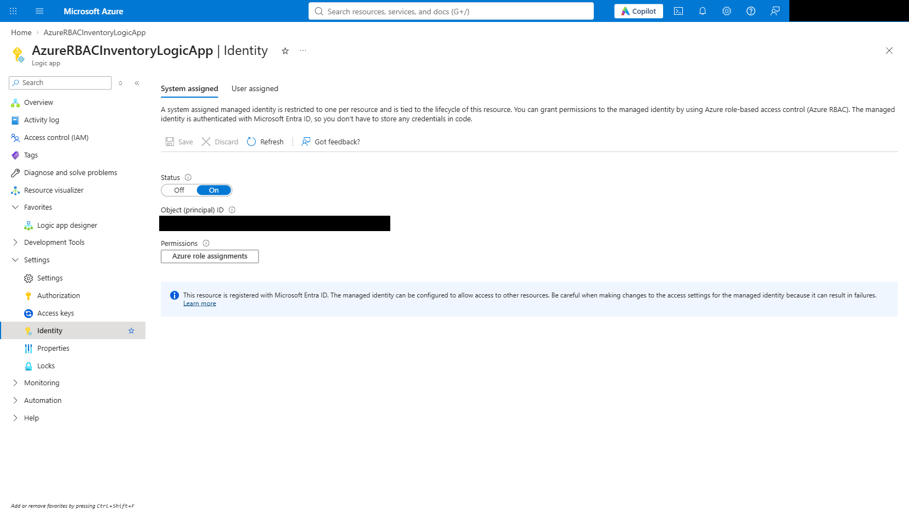
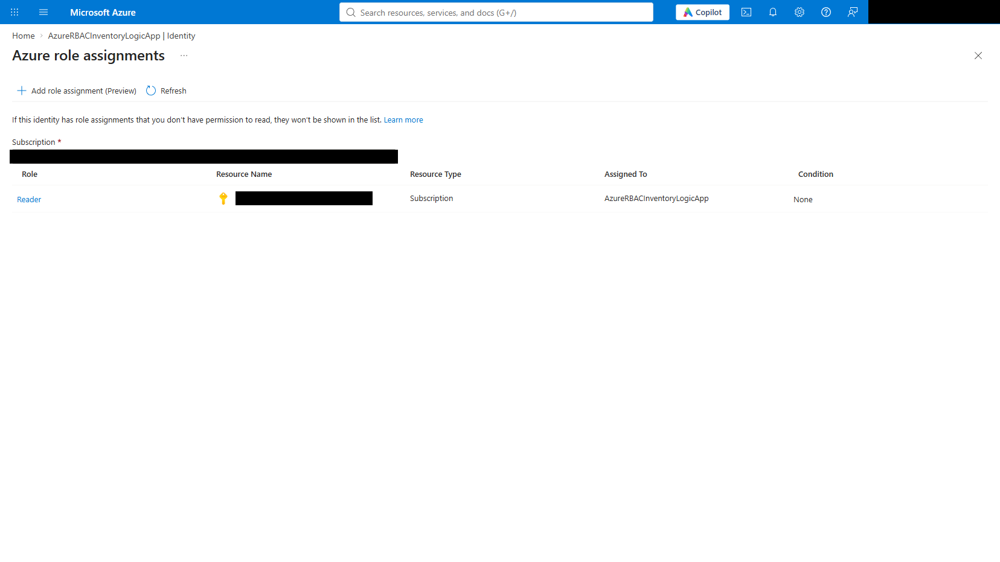
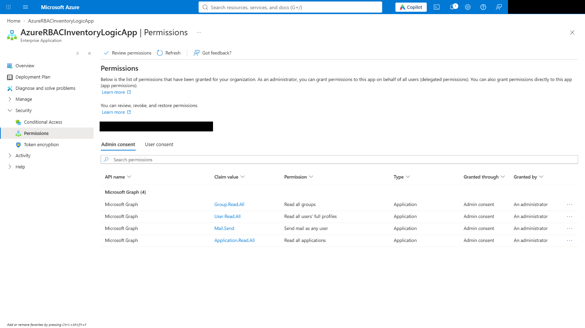
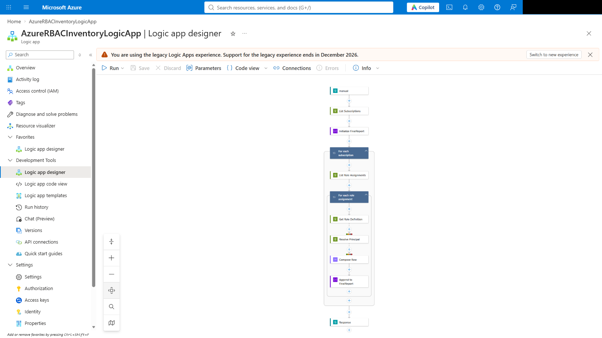
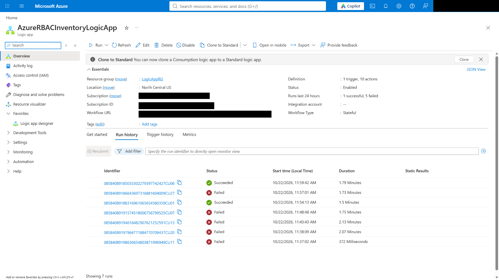
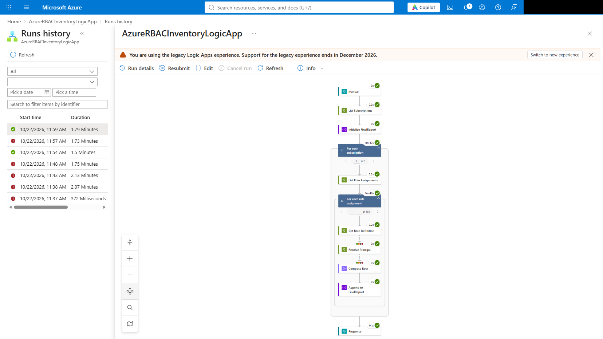
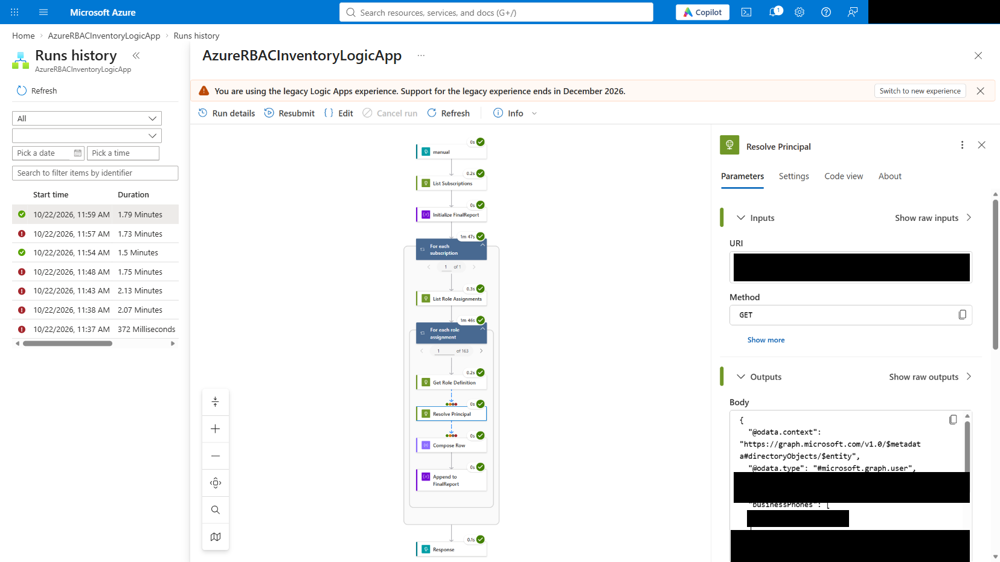
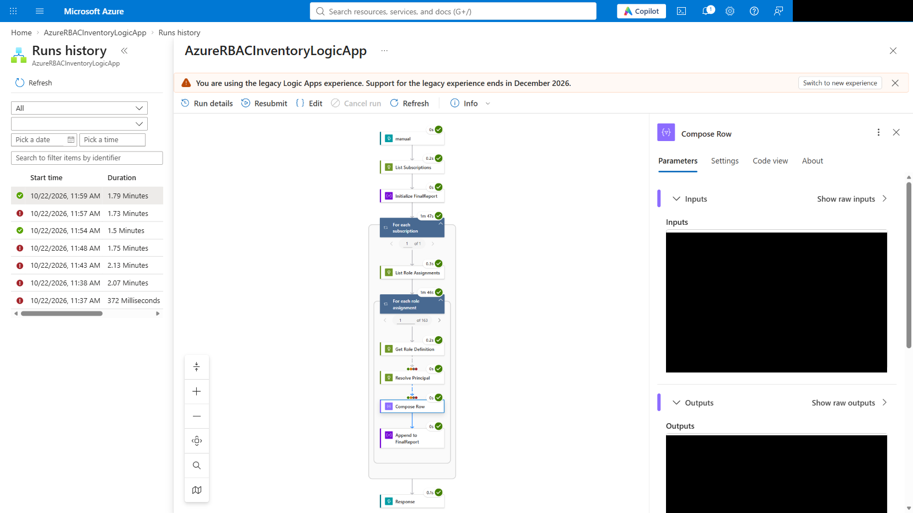

# Azure RBAC Inventory — Logic App (Managed Identity) Alternative

[<- Azure RBAC Inventory Module](../README.md)

An Azure Logic App that performs the same Azure subscription + Azure RBAC inventory + Microsoft Graph name resolution as the [Plugin](../Plugin/README.md) + [Entra Principal Resolver](../Entra%20Principal%20Resolver/README.md) pair — but as a **deterministic workflow with zero secrets**, using the Logic App's **system-assigned managed identity** instead of an Entra App Registration client secret.

---

## Why This Exists

The two Security Copilot plugins work well for ad-hoc chat questions, but chaining them reliably in a single automated flow (list subscriptions → list role assignments → resolve every principal name → merge into one report) turned out to need more than Security Copilot's orchestrator could guarantee:

- **No secrets to rotate.** The plugins need a long-lived Entra App Registration **client secret**. A Logic App's **system-assigned managed identity** needs no secret at all — Azure manages and rotates the credential automatically, and it cannot be copied out of the tenant.
- **A native Security Copilot Agent was evaluated first and does not currently support this.** Security Copilot's Agent framework lets an agent's `Instructions` declare `ChildSkills` it can call — in principle, enough to chain the ARM and Graph plugins deterministically instead of leaving tool selection to the orchestrator's judgment. In practice, a controlled, minimal reproduction confirmed that an agent's `ChildSkills` **only resolve skills inside the agent's own uploaded manifest** ("self skillset") — not skills belonging to a separately uploaded plugin, even when that plugin is correctly listed in `RequiredSkillsets` and fully enabled. Every call to a `ChildSkill` owned by another plugin failed with `Unable to find skill '<name>'`, regardless of whether the skill was referenced by its bare name or fully qualified as `SkillsetName.SkillName` — both of which are documented as valid. Because ARM and Microsoft Graph are different OAuth token audiences, the two plugins can't simply be merged into one manifest to work around this (a Security Copilot plugin manifest supports exactly one `Authorization` configuration). This Logic App has no such limitation — it is pure Azure Logic Apps control flow, not an LLM-mediated tool call.
- **Fully auditable, deterministic order of operations.** Every run executes the exact same sequence of HTTP calls — no orchestrator judgment, no prompt phrasing sensitivity, no "skill collision" between similarly described tools.

## Architecture

```
Logic App (system-assigned managed identity)
   │
   ├─ GET https://management.azure.com/subscriptions                                  (ARM, Reader role)
   │
   └─ For each subscription:
        ├─ GET .../roleAssignments                                                    (ARM, Reader role)
        └─ For each role assignment:
             ├─ GET .../roleDefinitions/{roleDefinitionId}                             (ARM — resolve role GUID → name)
             ├─ GET https://graph.microsoft.com/v1.0/directoryObjects/{principalId}    (Graph — resolve principal GUID → name)
             └─ Compose one merged row: Subscription | Principal Name | Principal Type | Role | Scope
```

- **Identity**: Logic App system-assigned managed identity — no client secret, no app registration.
- **Authorization granted to the identity**:
  - Azure RBAC **Reader** role at the subscription scope (for ARM)
  - Microsoft Graph **Application permissions** `User.Read.All`, `Group.Read.All`, `Application.Read.All` (admin-consented)
- **One Graph endpoint resolves every principal type.** `GET /directoryObjects/{id}` returns the object as its concrete type (`#microsoft.graph.user`, `#microsoft.graph.servicePrincipal`, or `#microsoft.graph.group`) in a single call — no need for three separate resolver skills like the Security Copilot companion plugin.
- **Role names are resolved from ARM directly**, not guessed from an LLM's training data — this correctly resolves **custom** role definitions (e.g. `acr-v1-dev-eus2-hosted-blob-read`), not just well-known built-in roles like Owner/Contributor/Reader.
- **Concurrency.** Both `Foreach` loops run with `runtimeConfiguration.concurrency.repetitions` set (5 for subscriptions, 20 for role assignments) so a tenant with hundreds of role assignments still completes within the Logic App Request trigger's synchronous response window.
- **Graceful degradation.** If a principal was deleted after the role assignment was created, `Resolve_Principal` returns 404 — the row is still included, labeled `Unresolved (<principalId>)`, instead of failing the whole run.

## What's Included

| Item | Description |
|---|---|
| [`workflow-definition.json`](workflow-definition.json) | Full Logic App workflow definition (trigger + all actions) — paste into **Logic app code view** or deploy with `az logic workflow create/update --definition` |
| [`Grant-ManagedIdentityGraphPermissions.ps1`](Grant-ManagedIdentityGraphPermissions.ps1) | One-time script to grant the managed identity's Graph application permissions (the Azure Portal has no "API permissions" UI for a managed identity, unlike an App Registration) |

---

## Step-by-Step Setup

### Step 1 — Create the Logic App with a system-assigned managed identity

Easiest via Azure CLI, which can enable the identity at creation time:

```powershell
az logic workflow create `
  --resource-group <your-resource-group> `
  --name AzureRBACInventoryLogicApp `
  --location <region> `
  --mi-system-assigned `
  --definition "@workflow-definition.json"
```

Or create it in the Azure Portal first, then enable **Identity > System assigned > Status: On** and paste `workflow-definition.json` into **Logic app code view**.

### Step 2 — Confirm the managed identity and note its Object (principal) ID

**Settings > Identity** shows the identity is **On** and its **Object (principal) ID** — you'll need this for the next two steps.



### Step 3 — Grant Azure RBAC Reader on the subscription

Click **Azure role assignments** on the same Identity page (or use **Access control (IAM)** on the subscription) and add the **Reader** role for this managed identity, scoped to the subscription(s) to inventory.

```powershell
az role assignment create `
  --assignee-object-id <managed-identity-principal-id> `
  --assignee-principal-type ServicePrincipal `
  --role "Reader" `
  --scope "/subscriptions/<subscription-id>"
```



### Step 4 — Grant Microsoft Graph application permissions

**The Azure Portal has no "API permissions" blade for a managed identity** the way it does for an App Registration — this step must be done via PowerShell/Graph API/CLI. Run [`Grant-ManagedIdentityGraphPermissions.ps1`](Grant-ManagedIdentityGraphPermissions.ps1):

```powershell
.\Grant-ManagedIdentityGraphPermissions.ps1 -ManagedIdentityPrincipalId "<managed-identity-principal-id>"
```

This grants `User.Read.All`, `Group.Read.All`, and `Application.Read.All` as application permissions with admin consent, directly via the Microsoft Graph API — equivalent to what **Grant admin consent** does for an App Registration.

You can verify the grant afterward in **Microsoft Entra ID > Enterprise applications** (search for the Logic App's name — every managed identity has a matching enterprise application/service principal) **> Security > Permissions**:



### Step 5 — Review the workflow

Open **Logic app designer**. The full deterministic chain is visible as a single diagram — list subscriptions, then for each subscription list role assignments, then for each role assignment resolve the role name and the principal name, compose a row, and append it to the final report:



### Step 6 — Run it

Trigger the Logic App (its Request trigger callback URL, found under **Overview > Trigger history**, or just click **Run** in the designer). The Logic App Overview page shows run history with status and duration:



### Step 7 — Inspect a successful run

Opening a completed run shows every action green, including the exact iteration counts — this run processed 163 role assignments across all its subscriptions, entirely automatically:



Drilling into the `Resolve Principal` action for one iteration shows the actual Microsoft Graph call and its result — a `GET /directoryObjects/{id}` call that returned `@odata.type: #microsoft.graph.user` and a resolved `displayName`:



And the `Compose Row` action shows the final merged structure for that same iteration — subscription, resolved principal name and type, resolved role name, and scope, all in one object ready to append to the report:



---

## Sample Output

A single run returns a JSON array where every row is fully resolved — no raw GUIDs left for the reader to decode. The following is illustrative, fictional example data (not real tenant output):

```json
[
  {
    "SubscriptionId": "<subscription-id>",
    "SubscriptionName": "<subscription-name>",
    "PrincipalId": "<principal-id>",
    "PrincipalName": "Jane Doe",
    "PrincipalType": "#microsoft.graph.user",
    "RoleName": "Owner",
    "Scope": "/subscriptions/<subscription-id>"
  },
  {
    "SubscriptionId": "<subscription-id>",
    "SubscriptionName": "<subscription-name>",
    "PrincipalId": "<principal-id>",
    "PrincipalName": "Contoso-SecurityScanner",
    "PrincipalType": "#microsoft.graph.servicePrincipal",
    "RoleName": "Reader",
    "Scope": "/subscriptions/<subscription-id>"
  }
]
```

## Known Considerations

- **Synchronous response window.** The Logic App's `Response` action returns the full merged array synchronously. For tenants with very large numbers of role assignments, raise the `Foreach` concurrency further, or switch the final step from a `Response` action to a notification (e.g. Microsoft Graph `sendMail` under the same managed identity, granted an additional `Mail.Send` application permission) so the workflow can run on a schedule (`Recurrence` trigger) without anyone waiting on an open HTTP connection.
- **Stale principals.** If a user, group, or service principal was deleted after the role assignment was created, Microsoft Graph returns 404 for that one lookup. The workflow tolerates this by design — the row is still included, labeled `Unresolved (<principalId>)`, rather than failing the whole run.
- **Least privilege.** The managed identity is granted **Reader**, not Owner/Contributor — it can enumerate subscriptions, role assignments, and role definitions, and read directory objects, but cannot modify anything in either Azure or Entra ID.

---

**Developer**: Dr Muataz Awad
